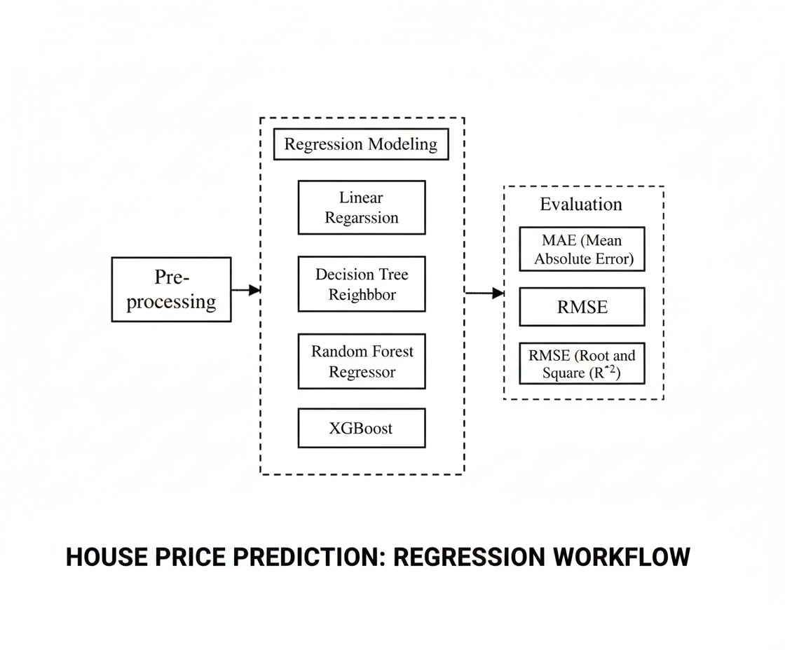

# Lab 02: California Housing Price Prediction

**Course:** ARTI308 Machine Learning | **Type:** Supervised learning (regression) | **Tools:** Python, Pandas, NumPy

## Objective
Frame a supervised machine learning problem: predicting median house values in California districts from housing and location features.

## Dataset
California Housing dataset (`california_housing_train.csv`): 17,000 districts and 9 numerical columns, with no missing values. Features include median income, housing median age, total rooms, total bedrooms, population, households, latitude, and longitude. The target is `median_house_value`.

## What I Did
- Loaded the dataset with Pandas
- Inspected its shape, column types, and completeness
- Identified the target variable and the input features

## Approach
Because the target is a continuous value, this is framed as a regression problem. A model would learn the relationship between district features and median house value so it can predict prices for unseen data.

## Files
- `lab2.ipynb`: notebook
- `ml-methodology-diagram.png`: methodology diagram
